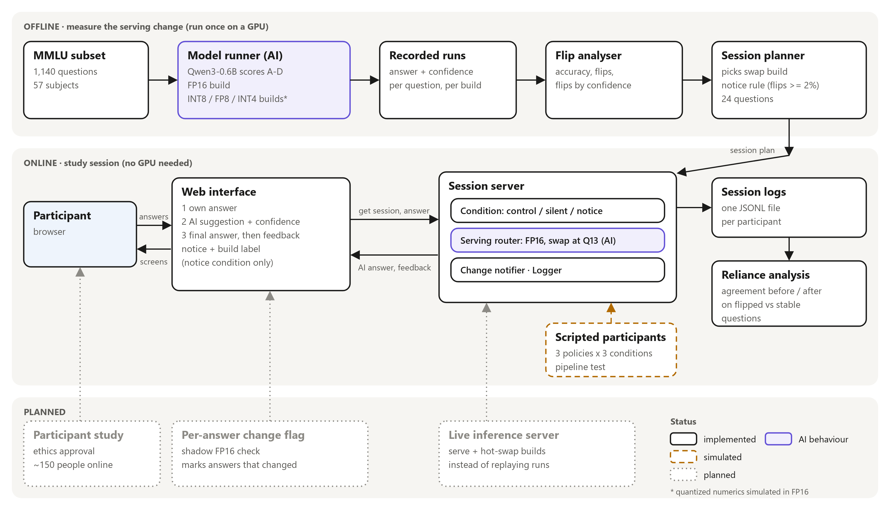

# Silent swap

**Does an unannounced change in how an AI model is served change how much people rely on it, and does telling them help?**

README prose: about 1073 words (code and commands not counted).

Intelligent Interactive Systems, Assignment 2 · Emmanuel Temitope Alo (student ID 3217089) · University of Birmingham
Submitted version: the commit tagged [`a2-submission`](https://github.com/emmanuelalo52/silent-swap/releases/tag/a2-submission); its hash is in the report.



## Project status

**What it is.** A study system with two halves. Offline, it measures how a serving change (quantizing the weights of the same model) changes individual answers while accuracy stays almost the same. Online, it runs a web study where people answer quiz questions with an AI assistant whose build is swapped at question 13: not at all (control), silently, or with a notice.

| Part | Status |
|---|---|
| MMLU subset, model runner, recorded runs for 6 serving builds | Implemented |
| Flip analysis and session planner (swap build, notice rule, 24 questions) | Implemented |
| Study server (conditions, serving router, change notifier, logger) | Implemented |
| Participant interface: own answer, suggestion and confidence, final answer, feedback, notice, build label, debrief | Implemented |
| Reliance analysis | Implemented |
| Live serving | **Simulated**: the server replays recorded model answers instead of running the model |
| Quantized builds | **Simulated numerics**: weights are rounded to INT8/FP8/INT4 and stored in FP16 (no low-bit kernels) |
| Participants | **Simulated**: scripted policies test the pipeline; they are not evidence about people |
| Study with real participants (needs ethics approval) | Planned |
| Live inference server that hot-swaps builds | Planned |
| Per-answer "this answer changed" flag (shadow FP16 check) | Planned |
| Counterbalanced question order | Planned |

## Technology stack

| Technology | What it does |
|---|---|
| Qwen3-0.6B (Qwen Team, Apache 2.0) | The assistant. Run locally; answers are scored from the logits of the four answer letters |
| PyTorch 2.11, Hugging Face Transformers 5.7 | Run the model; fake-quantize weights (`src/run_configs.py`) |
| MMLU test split (Hendrycks et al., 2021; MIT) | Question bank: 1,140 questions, 20 from each of 57 subjects |
| Python standard library (`http.server`) | Study server, so the study runs with no installs |
| HTML, CSS, plain JavaScript | Participant interface (`web/`) |
| pandas, huggingface_hub, matplotlib, pytest | Data download, flip chart, tests |
| Headless Chromium | Renders the diagram and captures storyboard screens |
| Claude Code (Anthropic) | AI coding assistant used to build the project; see AI assistance below |

Still undecided: the live serving engine (vLLM or my nano-vllm fork), whether to use real low-bit kernels, and the recruitment platform.

## Running or inspecting the work

The study runs on any machine with Python 3.10+, no GPU and no installs:

```bash
python3 src/server.py
```

Then open one of:

```text
http://localhost:8000/?pid=P01&c=control
http://localhost:8000/?pid=P02&c=silent
http://localhost:8000/?pid=P03&c=notice
```

Answers are logged to `logs/<pid>.jsonl` (not committed). Add `&demo=1` to try it without logging. To open a specific screen, add for example `&demo=1&jump=13&stage=notice`, or `&jump=15&stage=ai&own=A&final=B`.

Inspect the results without running anything:

- `analysis/flip_summary.md`: accuracy and flips for every build
- `analysis/flips_by_margin.png`: where flips happen
- `analysis/session_plan.json`: the 24 questions, both builds' answers, the notice text
- `analysis/session_summary_sim.md`: reliance measures from simulated sessions

Regenerate everything (the first step needs a CUDA GPU and the Qwen3-0.6B weights; about 8 minutes per build on a GTX 1650):

```bash
pip install torch transformers pandas huggingface_hub matplotlib pytest
python3 src/fetch_data.py
python3 src/run_configs.py --model /path/to/Qwen3-0.6B
python3 src/analyze_flips.py
python3 src/build_session.py
python3 src/simulate_participants.py && python3 src/analyze_sessions.py
python3 -m pytest -q
python3 docs/make_diagram.py && python3 docs/make_storyboards.py
```

No API keys are needed.

## Development record

Grouped by stage. Commit links point to the change.

**1. From the Assignment 1 question to a measurable task** ([89ff631](https://github.com/emmanuelalo52/silent-swap/commit/89ff631))
- A1 asked about a "familiar LLM assistant". Open chat cannot show whether a swap flipped an answer, so the study uses four-option MMLU questions with known answers.
- Answers are scored from the four answer-letter logits instead of being sampled, so a difference between builds comes from the build, not from sampling randomness.

**2. Measuring serving changes** ([4aaade2](https://github.com/emmanuelalo52/silent-swap/commit/4aaade2))
- The same Qwen3-0.6B weights were run as six builds: FP32, FP16, INT8, FP8, INT4 (group 128) and INT4 (group 32).
- Naive INT4 with group 128 fell to 25.9% accuracy, about chance, so it breaks the model rather than quietly changing it. The session planner therefore only accepts a swap build within 2 points of FP16, and picks the one that flips the most answers.
- FP32 against FP16 was measured as the numerical-noise floor, and the 2% notice threshold sits above it.

**3. Study server and interface** ([a7a9fcd](https://github.com/emmanuelalo52/silent-swap/commit/a7a9fcd))
- The participant answers alone before seeing the assistant, which avoids anchoring and makes reliance measurable as switching.
- Correct answers stay on the server and are only returned after a final answer. Participant IDs are restricted to letters, digits, `-` and `_` so they cannot be used to write outside `logs/` (covered by the tests).
- Testing showed the update notice opened over a blank page; it now draws the question underneath.
- Feedback marks the participant's first answer when they changed it, so abandoning a correct answer is visible.

**4. Evidence and documentation** ([f4750c0](https://github.com/emmanuelalo52/silent-swap/commit/f4750c0))
- The planner first chose human sexuality as a quiz subject; it is now excluded so the study needs no content warnings.
- Scripted participants run all three conditions to test logging and analysis. They are labelled as simulated everywhere.
- The storyboards are captured from the running app through demo URLs, and the system diagram is drawn from code.

What was checked: 11 unit tests (`python3 -m pytest -q`), API responses for valid and invalid input, and a screenshot of every interface state used in the report.

## AI assistance

- **Tool:** Claude Code (Claude Opus 5.5, Anthropic), working in the terminal on this repository.
- **My part:** I chose the problem and research question in Assignment 1 (silent serving changes and reliance on AI) and wrote most of that review; Claude gave feedback on my drafts and drafted the gap and contribution sections, which I edited. For this assignment I set the scope: build a study system that answers the A1 question, using the module's Weeks 1-4 concepts.
- **What Claude Code produced:** the code in `src/`, `web/`, `tests/` and `docs/`, this README and the draft report. The design choices follow the A1 question and the module guidelines; the report explains each one. I used its output as produced and asked it to complete this README and publish the repository.
- **How the result was checked:** Claude Code ran the 11 unit tests, sent valid and invalid requests to the API, captured every interface state shown in the report, and the report's numbers are read directly from `analysis/` so they match the recorded runs. Commit messages credit Claude Code as co-author.

## Additional files

- `docs/`: system diagram, storyboards, and the scripts that draw them
- `analysis/`: measured results and the session plan
- `runs/`: the recorded model answers for each build (one JSON per build)
- `logs/sim/`: simulated session logs
- The report itself is submitted on Canvas; no ZIP is needed.
